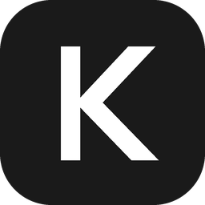

<h1 align="center">Kaggle Studio</h1>

<a href="README.md" lang="zh-CN">中文</a> · <a href="README.en.md" lang="en">English</a> · <a href="README.fr.md" lang="fr">Français</a> · <a href="README.ru.md" lang="ru">Русский</a> · <a href="README.es.md" lang="es">Español</a> · <a href="README.ar.md" lang="ar" dir="rtl">العربية</a>

Changez de modèle. Démarrez et arrêtez vos sessions. Depuis votre téléphone.

Réunissez vos propres modèles de conversation, de génération d’images et de vidéos dans une application Android. Autorisez Cloudflare et saisissez votre jeton API Kaggle pour retrouver une installation existante ou préparer votre déploiement personnel.

## Votre téléphone devient le panneau de contrôle

- **Changer de modèle en le sélectionnant :** choisissez un modèle déjà déployé dans la liste. Studio gère la fin de la session précédente et le chargement du modèle choisi.
- **Démarrer lorsque vous avez besoin du GPU :** lancez une session GPU Kaggle depuis la rubrique Compute et suivez le chargement dans l’application.
- **Arrêter même loin de l’ordinateur :** demandez l’arrêt depuis le téléphone et vérifiez que Kaggle confirme la fin de la session. La gestion quotidienne ne nécessite ni ordinateur, ni bureau à distance, ni ligne de commande.

Le changement n’est pas instantané : Studio attend la fin de la session précédente, puis charge le modèle sélectionné. Un seul modèle GPU fonctionne à la fois.

## Fonctionnalités

| Domaine | Fonctions |
|---|---|
| Conversation | Modèles GGUF, conversations longues et rendu des formules mathématiques ; les modèles de vision compatibles acceptent des photos et des questions sur les images |
| Images | Profils SDXL et Z-Image ; génération à partir de texte ou d’une image de référence |
| Vidéos | Profils Wan ; génération à partir de texte ou d’images avec les modèles compatibles |
| Déploiement personnel | Worker, D1, Tunnel privé et service VPC dans votre compte Cloudflare, avec votre propre adresse workers.dev |
| Gestion | Réutilisation d’une installation, réparation du gestionnaire, mise à jour des jetons et des modèles, suppression de l’autorisation d’un appareil ou d’un déploiement vérifié |

## Prise en main

1. Téléchargez l’APK depuis le [site](https://studio.entropy1221.cc.cd) et installez-le sur Android 8.0 ou une version ultérieure.
2. Connectez-vous à Cloudflare et autorisez votre propre compte.
3. Saisissez votre jeton API Kaggle. Effectuez sur Kaggle toute vérification téléphonique requise.
4. Choisissez les modèles, puis connectez une installation existante ou créez votre déploiement.
5. Une fois le déploiement terminé, ouvrez Studio, démarrez une session dans Compute et attendez que le modèle soit prêt.

L’APK officiel n’impose pas à chaque utilisateur de créer un client OAuth ou de posséder un nom de domaine. Les ressources cloud restent dans les comptes de l’utilisateur ; l’historique et les médias restent sur l’appareil.

## Organisation du dépôt

| Répertoire | Contenu |
|---|---|
| `android/` | Conteneur Android natif, stockage chiffré, passerelle réseau et interface React |
| `manager/` | Gestionnaire Cloudflare, schémas de base de données et environnement Kaggle |
| `shared/` | Profils des modèles, paramètres de contexte et vérification de l’identité des Notebooks |
| `publisher/` | Ressources et modèle de page du site |
| `scripts/`, `tests/` | Outils de construction et vérifications locales |

Consultez l’[architecture](docs/architecture.md), le [développement](docs/development.md) et la [publication](docs/publishing.md). Les guides techniques détaillés sont actuellement en chinois. Les traductions du README n’ajoutent pas de langues à l’interface de l’application.

## Identifiants et ressources

- La configuration Cloudflare utilise PKCE. Le jeton Kaggle est conservé comme Secret dans votre Worker ; les requêtes quotidiennes utilisent les clés de l’appareil.
- Retirer l’autorisation d’un appareil ne retire pas les autres appareils et ne remplace pas les clés de service d’origine.
- **Repair manager program only** met à jour le Worker existant et conserve le Notebook, la configuration, les enregistrements des sessions et les secrets.
- Supprimer un déploiement exige de vérifier son propriétaire et son nom exact. Désinstaller l’application n’arrête pas les sessions GPU et ne supprime pas les ressources cloud.
- Ce dépôt ne contient ni clé de signature, ni jeton personnel, ni base de données utilisateur, ni journal d’exécution, ni poids de modèle. Le Client ID OAuth de l’éditeur est un identifiant public d’application, pas un secret de compte.

## Vérification et limites des modèles

Kaggle contrôle l’accès aux GPU, la vérification téléphonique, les quotas et la disponibilité. Les capacités et les besoins en mémoire varient selon le modèle. Un déploiement terminé ne garantit pas que l’inférence fonctionnera.

Les vérifications locales couvrent la reprise de l’autorisation, la réutilisation des installations, l’état d’arrêt, le retrait d’autorisation des appareils, les tâches en arrière-plan, les formules et les parcours d’interface. Les contrôles d’images et de vidéos incluent les paramètres et les résultats numériques invalides. Les tests simulés ne valident pas la qualité d’image, la mémoire nécessaire ou les performances sur une véritable carte T4 ; vérifiez ces points sur votre matériel.

Les poids et les dépendances conservent leurs licences respectives. Consultez les [mentions tierces](android/web/public/third-party-notices.txt).

Projet indépendant, sans affiliation ni soutien officiel de Cloudflare, Kaggle, Google ou des éditeurs de modèles.
